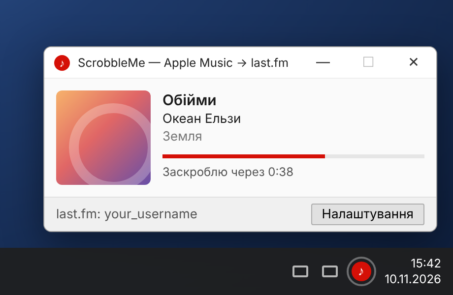
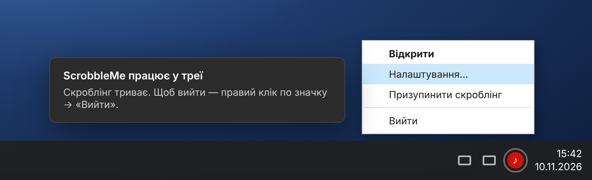
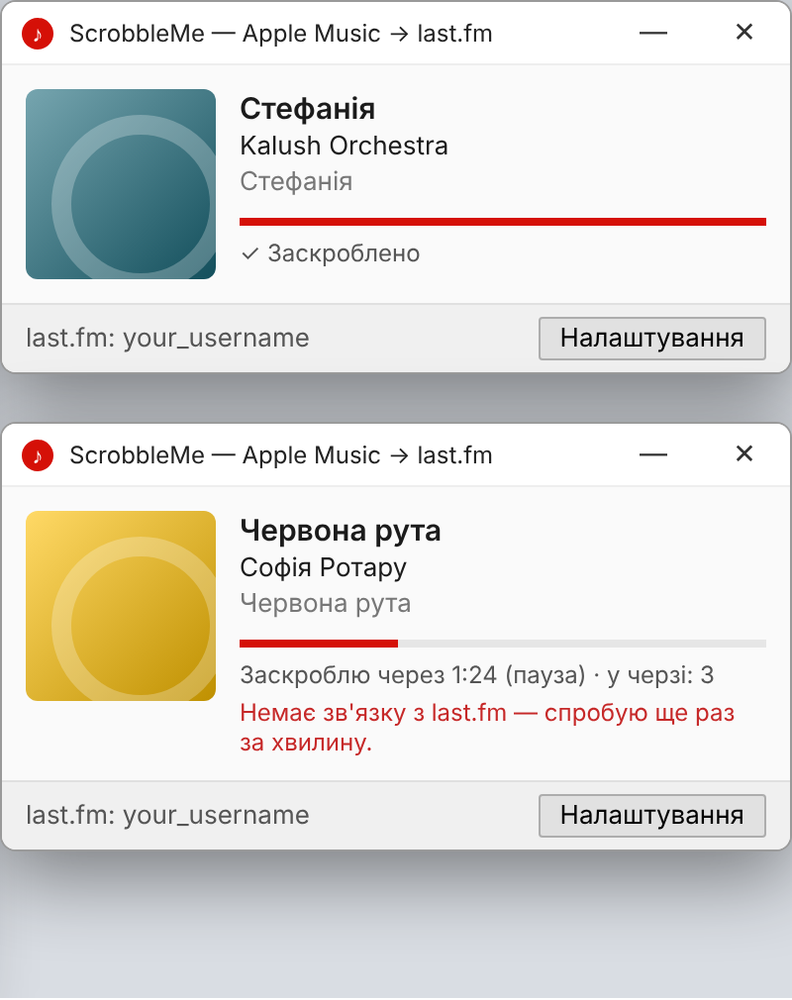
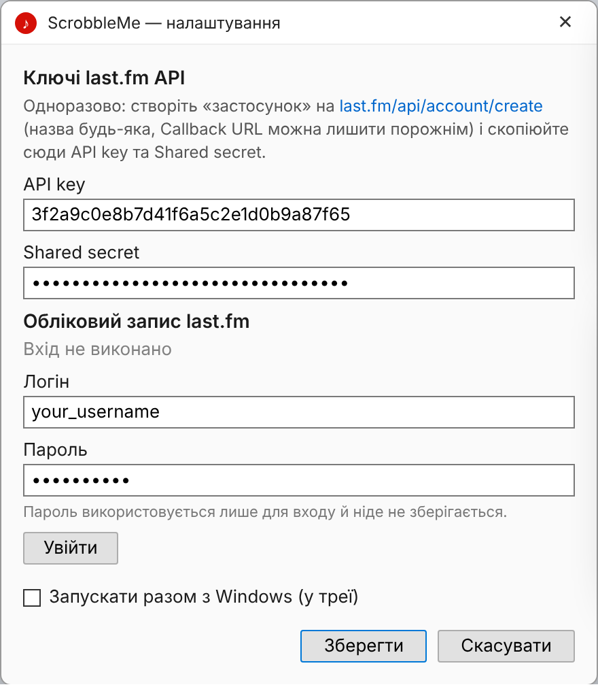

<div align="center">

# ♪ ScrobbleMe

**Scrobble Apple Music for Windows to [last.fm](https://www.last.fm).**
Sits quietly in the system tray and logs everything you listen to.

[](https://github.com/SomeoneWickedThisWayComes/scrobble_me/actions/workflows/build.yml)




</div>

> [!NOTE]
> The images in this README are mockups rendered from the window layouts. On real Windows the font
> and window frames are the system ones; layout and text are the same. The app's interface is in Ukrainian.

---

## ✨ Features

| | |
|---|---|
| 🎵 **Knows what's playing** | Title, artist, album and cover art from Apple Music, refreshed every second. |
| 📡 **Scrobbles by the rules** | As last.fm requires: track longer than 30 s, played for half its length or 4 minutes. Pauses and seeking don't count. Also sends "Scrobbling now". |
| 🔁 **Repeat one** | Every replay of the same song is a separate scrobble. |
| 📴 **Never loses scrobbles** | Offline scrobbles wait in a queue on disk and are sent as soon as the connection is back. |
| 🖥️ **Lives in the tray** | The close button hides the window instead of quitting. Optional start with Windows. |
| ⏸️ **Pause** | "Pause scrobbling" in the tray menu for things you don't want on your profile. |
| 🔒 **Safe** | Your password is never stored. Keys are encrypted with Windows DPAPI and can't be decrypted on another PC. |

## 🖼️ Screenshots

<table>
<tr>
<td width="50%" valign="top">

**System tray.** The close button hides the window here. Left-click the icon to open it, right-click for the menu.



</td>
<td width="50%" valign="top">

**States.** Scrobbled ✓, paused, queued, last.fm unreachable.



</td>
</tr>
</table>

## 🚀 Installation

1. **Download `ScrobbleMe.exe`**:
   - from [Releases](https://github.com/SomeoneWickedThisWayComes/scrobble_me/releases), once a release is published, or
   - from [Actions](https://github.com/SomeoneWickedThisWayComes/scrobble_me/actions/workflows/build.yml) → latest green run → artifact **ScrobbleMe-win-x64** (a zip with the exe inside).
2. **Put the exe anywhere** (e.g. `%USERPROFILE%\Apps\ScrobbleMe\`) and run it.
   No need to install .NET — everything is bundled.

> [!TIP]
> Windows SmartScreen may warn about an "unknown publisher" because the exe isn't signed.
> Click **More info → Run anyway**.

**Requirements:** Windows 10 1809+ or Windows 11, and the **Apple Music** app from the Microsoft Store.

## 🔑 First run: signing in to last.fm



last.fm requires every app to have its own API key. You create it once; it takes about two minutes:

1. Open **[last.fm/api/account/create](https://www.last.fm/api/account/create)**.
2. **Application name** — anything (e.g. `ScrobbleMe`).
   **Callback URL** — leave empty. Click **Submit**.
3. Copy the **API key** and **Shared secret** into ScrobbleMe's settings.
4. Enter your last.fm username and password → **Sign in** («Увійти»).

The password is used only once: the app exchanges it for a session key and works with that key from then on.

**Check:** play a song in Apple Music. Your last.fm profile will show *Scrobbling now*, and after half the track the window will say **✓ Scrobbled** («Заскроблено»).

<br clear="right">

## 🩺 Troubleshooting

<details>
<summary><b>"Apple Music is not running" while music is playing</b></summary>

Only the **new** Apple Music app from the Microsoft Store is supported. The old iTunes for Windows
doesn't report what's playing to the system.
</details>

<details>
<summary><b>The track is shown but never scrobbled</b></summary>

Check the status line under the progress bar. last.fm doesn't accept tracks shorter than 30 s.
Details are in the log: `%APPDATA%\ScrobbleMe\log.txt`.
</details>

<details>
<summary><b>"last.fm rejected the session — sign in again"</b></summary>

Settings → **Sign out** → sign in again. Queued scrobbles are kept.
</details>

<details>
<summary><b>Artist or album shows up wrong on last.fm</b></summary>

Apple Music sends them as a single "Artist — Album" string, and the app splits it on the dash
([why](docs/decisions.md#d-2-розрізати-виконавець--альбом)). If it goes wrong, open an issue with the track name.
</details>

### Where the data lives

Everything is stored in `%APPDATA%\ScrobbleMe\`:

| File | Contents |
|---|---|
| `settings.json` | Settings. The API secret and session key are encrypted. |
| `queue.json` | Scrobbles waiting to be sent. |
| `log.txt` | Log: what played, what was scrobbled, errors. |

## 🛠️ For developers

```
src/ScrobbleMe/
├── Core/                     Windows-independent logic (testable on any OS)
│   ├── ScrobbleTracker.cs      when to scrobble: tracks actual listening time
│   ├── AppleMusicMetadata.cs   splits "Artist — Album"
│   ├── LastFmClient.cs         last.fm API calls
│   ├── LastFmSignature.cs      request signing (api_sig)
│   └── ScrobbleQueue.cs        on-disk scrobble queue
├── Services/                 Windows: player reading, settings, autostart, log
├── UI/                       WPF windows and the tray icon
└── App.xaml.cs               wires everything together, polls the player once a second
tests/ScrobbleMe.Tests/       tests for Core
docs/decisions.md             decision log: what was chosen and why (Ukrainian)
.github/workflows/build.yml   CI: tests + exe on every push, release on v* tags
```

Requires the **.NET 8 SDK**.

```bash
dotnet test tests/ScrobbleMe.Tests
```

```bash
dotnet publish src/ScrobbleMe/ScrobbleMe.csproj -c Release -r win-x64 --self-contained -p:PublishSingleFile=true -p:EnableCompressionInSingleFile=true -p:IncludeNativeLibrariesForSelfExtract=true -o publish
```

It builds on Linux/macOS too (`EnableWindowsTargeting`), but runs on Windows only.

**Releasing:** push a tag like `v0.1.0` and CI will create a release with the exe.

See the [decision log](docs/decisions.md) for the reasoning behind the design.
